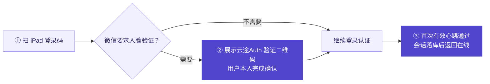
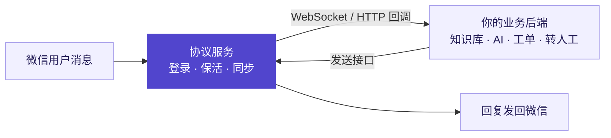

# 云途 · 微信iPad协议（人脸版）

**云途Auth 人脸验证直登 · 多画像登录 · 实时消息同步 · 多账号私有化部署**

> **沉心打磨协议内核，**
> **坚守原生开发，**
> **稳定性交由时间检验。**
>
> **沉心打磨协议内核，**
> **坚守原生开发，**
> **稳定性交由时间检验。**
>
> **沉心打磨协议内核，**
> **坚守原生开发，**
> **稳定性交由时间检验。**

云途微信iPad协议面向 AI 客服、聚合聊天、私域 SCRM、社群运营与微信机器人，提供可接入自有业务系统的微信底层接口能力。

**要测试地址？联系作者：** Telegram [@yuntuCTO](https://t.me/yuntuCTO) · QQ `1670645753` · 微信 `69871713`

[核心能力](#核心能力) · [人脸登录](#云途auth-人脸验证登录) · [功能清单](#功能介绍) · [消息同步](#消息同步) · [接入示例](#接入示例) · [交付部署](#交付与部署) · [联系作者](#联系作者)

---

## 近期更新

| 日期 | 开发进展 |
| :--- | :--- |
| **2026-11-13** | 修复 **car→iPad 外挂风控**问题。 |
| **2026-11-07** | 新增 **iPad 人脸版直登与云途Auth 验证流程**、会话接管。 |
| **2026-11-07** | 新增语音转发接口。 |
| **2026-11-07** | 优化 Mac 登录 CCD。 |
| **2026-11-01** | 新增多群转发与分功能在线门槛，登录成功后自动回报账号信息。 |
| **2026-10-22** | 新增 Mac 新协议登录与滑块验证，适配既有会话与业务；修复 HTTP 启动监听冲突并补齐离线回归。 |
| **2026-10-21** | 修正朋友圈图片上传进度误判。 |
| **2026-10-21** | 接入用户网络 UUID 代理，**解决Mac登录不在同局域网问题**，保留原 SOCKS5 用法。 |
| **2026-10-20** | 修复图片下载取消贯通与超时任务残留。 |
| **2026-10-16 ～ 18** | 统一登录编排与协议迁移、首次心跳确认、实时在线状态、长连接代次隔离与恢复保护、设备画像连续性。 |
| **…** | 更早的更新记录。 |

以上为开发记录，不代表所有功能均已完成线上验收。

## 核心能力

**它不是一个成品机器人，而是一套可以接进你业务系统的微信接口层。** 登录、保活、消息收发与同步由协议服务负责；客服话术、客户标签、工单流转、自动化规则由你自己的系统决定。

| 能力 | 说明 |
| :--- | :--- |
| **多设备画像登录** | iPad 直登、iPad 人脸版直登、Mac 新协议、Linux、车载；同一套会话体系与卡密接入，按业务场景选择画像。 |
| **统一登录编排** | 取码、轮询、验证码、滑块、取消与重试由统一流程管理，登录状态可实时查询，过期回调自动隔离。 |
| **云途Auth 人脸验证** | 微信下发人脸挑战时按需生成第二张验证二维码，由用户本人在云途Auth 里完成确认，验证通过后继续认证并接管会话。 |
| **三种消息同步** | WebSocket 长连接推送、HTTP 回调、主动同步拉取，适配不同业务后端的接收方式。 |
| **多账号会话管理** | 一个 key 对应一个微信会话；连接管理器统一统计总数 / 在线 / 离线，消息处理按连接分片进工作池。 |
| **长期在线保活** | 心跳巡检、掉线唤醒重连、长连接代次隔离与发送队列、重启后批量错峰重登。 |
| **完整业务面** | 消息、好友、群、朋友圈、标签、收藏、公众号、小程序、视频号、企业微信、微信小店等模块均有对外接口。 |
| **可裁剪交付** | Docker 镜像 / Linux 二进制 / Windows 程序三种形态；提供编译期剔除前后台页面与管理端的纯接口交付版。 |

## 云途Auth 人脸验证登录

**微信要求刷脸时，让用户在当前登录流程里继续验证，而不是重新扫一次码。**

人脸版直登是独立入口。用户先扫 iPad 登录码；只有微信明确要求人脸验证时，状态接口才返回验证地址，前端据此展示 **云途Auth 验证二维码**，由用户本人在云途Auth 里完成确认。不需要人脸验证时，不会出现第二张码；PIN 等其他挑战也不会误出人脸码。

| 前端怎么接 | 怎么判断成功 |
| :--- | :--- |
| 持续查询登录状态，收到人脸验证要求后再展示第二张二维码。此入口为独立入口，与其他登录方式分开，不可交叉调用。 | 人脸验证回执不等于上线。挑战解除、认证成功、收到首次有效心跳并保存会话后，服务端才返回在线。 |

换码、退出、过期与票据轮换都会废弃旧验证链接；验证地址使用短时票据，网关日志不记录其查询串。

> [!NOTE]
> 人脸登录链路已完成离线验证（内存对端 + 数据库/缓存替身）。真实微信账号与云途Auth 设备的端到端验收尚未完成，接入前请预留联调时间。

## 功能介绍

### 登录与会话

主力登录入口为 **iPad 人脸版一码登录**、**Mac 新协议登录** 与 **Linux 登录**。

- **iPad 人脸版一码登录**：扫一张 iPad 登录码即可完成登录；微信下发人脸挑战时由云途Auth 接续验证，无需重新取码。
- **Mac 新协议登录**：Mac 画像取码与登录，含滑块验证拦截处理。
- **Linux 登录**：Linux 画像取码、登录与在线保活。

会话与保活：登录状态轮询 · 在线状态查询 · 掉线唤醒重连 · 退出登录 · 初始化与通讯录拉取进度查询 · 数字验证码提交 · A16 登录态免扫码恢复 · 62 数据 + 手机号密码登录 · 统一登录的启动 / 迁移 / 状态 / 取消 / 重试。

### 消息收发

文本 · 图片 · 语音 · 表情 · 名片 · 应用卡片 · 小程序卡片高清封面 · 合并转发 · 消息撤回 · 图片/视频/表情/语音转发 · 语音转文字 · 不显示会话的文本发送 · 标记好友消息全部已读 · 历史消息同步 · 群发文本与群发图片。

### 文件与媒体

CDN 图片上传（发送 / 仅上传两种）· 视频上传 · 大文件分片上传（返回 fileid 与 aeskey 供构造消息）· 获取消息原图 · 获取消息视频 · 获取消息语音 · 下载表情 GIF · 附件上传 · 媒体下载。

### 好友与联系人

联系人搜索 · 好友列表 / 群列表 / 公众号列表 · 联系人详情批量查询 · 好友关系查询 · 添加好友与验证申请 · 同意好友申请 · 删除联系人 · 修改备注 · 上传通讯录 · 单向好友（僵尸粉）检测与进度查询 · 自动通过好友申请。

**联系人缓存：** 缓存联系人 / 群 / 公众号查询、手工触发缓存同步、同步进度查询、快照重建，适合通讯录量大、需要低延迟读取的业务。

### 群管理与群发

建群 · 邀请入群 · 添加群成员 · 移除群成员 · 退出群聊 · 转让群主 · 群公告 · 群名称 · 群内昵称 · 群二维码 · 群详情与成员详情 · 入群验证开关 · 管理员任免 · 同意入群邀请 · 保存群到通讯录 · 拍一拍 · 链接进群。

**多群转发：** 单任务依次发送至该账号的群聊，单次上限 300 群，随机间隔发送、每 20 群回报进度、连续失败自动暂停，同一账号同时只允许一个转发任务。

### 朋友圈

图文发布 · XML 方式发布 · 图片上传 · 视频上传 · 时间线查询 · 用户主页查询 · 单条详情查询 · 点赞与评论 · 收藏内容转朋友圈 · 可见范围设置 · 朋友圈封面设置 · 朋友圈同步 · 媒体下载。

### 标签与收藏

标签列表 · 新增 / 删除 / 修改标签 · 按标签拉取好友列表；收藏同步 · 收藏列表 · 收藏项批量获取 · 收藏项批量删除。

### 公众号与小程序

关注公众号 · 公众号历史文章 · 文章详情与扩展信息 · 文章点赞 · 文章阅读数 · A8Key 获取 · 小程序 JSLogin · 小程序数据操作 · SDK OAuth 授权 · 扫码登录授权与确认 · 公众号登录授权。

### 视频号

视频号登录 · 搜索与热搜词 · 话题列表 · 推荐流 · 用户主页 · 关注 · 评论与评论详情 · 点赞 · 私信会话与文本发送。

### 企业微信

企微联系人搜索 / 申请添加 / 添加 / 查询 / 同步 / 备注；企微群建群 / 同步 / 转让群主 / 添加成员 / 邀请成员 / 移除成员 / 成员查询 / 群信息 / 群二维码 / 管理员任免 / 入群接受与验证设置 / 群名称 / 成员昵称 / 群公告 / 解散群。

### 微信小店

小店登录确认 · 外部设备登录确认与获取 · 扫码事件上报。

### 账号与设备

个人资料查询 · 修改昵称 / 签名 / 性别 · 头像上传 · 修改密码 · 设置微信号 · 我的二维码 · 关键词回复 · 入群欢迎语 · 管理员关键词 · 踢人关键词 · 邀请关键词 · 功能开关 · 拍一拍开关 · 账号代理设置；在线设备信息 · 安全设备查询与删除 · 绑定硬件设备查询。

### 支付与红包

绑定银行卡列表 · 收款码生成 · 收款 · 红包创建 / 领取 / 明细查询 / 红包列表 · 转账预创建与确认。

> [!WARNING]
> 资金类接口涉及真实账户与资金流转，请自行评估合规要求、风控规则与操作授权，并在测试环境充分验证后再接入生产。

### 其他

附近的人查询 · 微信运动步数上报 · 排行榜点赞数 · 消息缓存读取 · 指令状态更新。

## 消息同步

| 方式 | 适用场景 | 特点 |
| :--- | :--- | :--- |
| **WebSocket 长连接** | 自建后端常驻进程、聚合聊天工作台 | 消息实时推送，延迟最低，需维护连接与重连。 |
| **HTTP 回调** | Serverless、已有 Web 服务、跨语言后端 | 支持设置 / 查询 / 删除 / 测试回调地址，消息直接 POST 到你的接口。 |
| **主动同步拉取** | 定时任务、离线补偿、消息补采 | 由业务侧按节奏拉取，适合不便暴露公网回调的环境。 |

## 接入示例

**以 AI 客服为例：** 微信消息通过 WebSocket 或 HTTP 回调进入业务后端 → 后端查知识库、生成回复或转人工 → 调用发送接口把回复发回微信。协议服务负责登录与消息通道，客服规则完全由业务系统决定。

| 如果你在做 | 可以这样接 |
| :--- | :--- |
| **聚合聊天 / 多客服工作台** | 一个工作台收取多个账号消息，按账号与会话分配给客服，统一回复与质检。 |
| **微信机器人 / 社群助手** | 群消息触发关键词回复、业务提醒、入群欢迎，或对接自有群管理工具。 |
| **私域 SCRM / 工单系统** | 联系人与标签同步到客户库，把咨询、订单、售后消息关联到工单与客户画像。 |
| **内容运营 / 视频号业务** | 公众号文章采集、视频号搜索与互动、朋友圈内容发布统一走接口。 |

## 交付与部署

| 形态 | 内容 | 适用 |
| :--- | :--- | :--- |
| **Docker 镜像** | 离线构建出的客户镜像，非 root 运行，含镜像内回归校验 | 已有容器平台、需要标准化交付 |
| **Linux 二进制** | 程序 + 启动脚本 + 使用说明 + 接口指南 + 构建信息 + 校验和 | 自有 Linux 服务器直接部署 |
| **Windows 程序** | 可执行程序 + 启动脚本 | Windows 服务器或本地验证 |

**纯接口交付版：** 通过编译标签在构建期剔除前台页面、客户个人中心与管理端接口，只保留协议接口，适合已有自研管理台、不希望暴露额外 Web 面的客户。

**带管理台的版本：** 客户扫码登录落地页、客户个人中心（卡密换会话、在线时长与到期查询、退出）、管理控制台（在线账号与登录审计、多级代理管理员、积分流水、卡密生成与管理、公告、代理节点池按省份加权与批量测活、品牌配置）。

| 项目 | 说明 |
| :--- | :--- |
| **服务端** | Go · Gin · MySQL · Redis · GORM · Protobuf |
| **实时通道** | Gorilla WebSocket |
| **管理台前端** | Vue 3 · TypeScript · Vite · Element Plus · Pinia · ECharts |
| **接口文档** | Swagger，随服务启动提供 |
| **配套服务** | 自建滑块验证服务（人工票据转发，独立容器部署）、UUID 服务、代理隧道接入 |
| **授权模型** | 主机授权指纹绑定 + 业务卡密（有效期 / 类型 / 封禁状态校验），支持离线宽限 |

> [!IMPORTANT]
> Mac 新协议登录依赖原生库，Linux 侧仅支持 **amd64 + glibc 2.38 及以上**，不支持 musl/Alpine 与 arm64。选型前请先确认目标环境。

## 能力边界

- 各交付版本包含的模块可能不同，**最终能力以接口清单与目标环境联调结果为准**。
- 人脸登录、Mac 新协议等新增链路以离线验证为主，真实账号端到端验收需单独安排。
- 协议能力受微信服务端策略影响，接口可用性可能随官方调整而变化，维保范围与周期在合作时约定。
- 完整接口清单、Swagger 文档、测试地址、部署手册与接入指南 [联系作者](#联系作者) 索取，本仓库不公开内部接口路径。

## 联系作者

**要测试地址、接口文档或报价，直接联系作者：**

| 渠道 | 账号 |
| :--- | :--- |
| **Telegram** | [@yuntuCTO](https://t.me/yuntuCTO) |
| **QQ** | `1670645753` |
| **微信** | `69871713` |

**测试地址私聊索取**，作者会提供在线测试环境与 Swagger 接口文档。建议先跑通登录取码、消息收发与消息同步，确认满足业务需求后再谈授权与部署。

添加时请备注「微信 iPad 协议」，并说明：

1. 业务场景（AI 客服 / 聚合聊天 / SCRM / 社群运营 / 其他）
2. 预计账号规模与部署环境（Docker / Linux 发行版 / Windows）
3. 希望优先验证的功能模块

云途提供 **源码授权**、**接口租用** 与 **私有化部署** 三种合作方式，报价按账号规模、模块范围与维保周期评估。

> [!CAUTION]
> 测试地址、卡密与账号凭据只走上述私有渠道。请不要在公开 Issue 或评论中提交账号凭据、卡密、登录二维码、代理口令、数据库连接串或生产配置。

## 重要声明

- 云途 **不是腾讯或微信官方产品**，与腾讯公司无任何隶属或授权关系。"微信" 商标归其权利人所有。
- 仅供 **在自有或已获得明确授权的账号上** 进行合法业务系统集成、企业内部自动化与安全研究使用。
- 使用者应自行遵守微信软件许可及服务协议、所在平台规则与当地法律法规。因使用本接口产生的账号限制、封禁、数据损失或法律纠纷，由使用者自行承担。
- 禁止用于骚扰营销、批量注册、诈骗、赌博、侵犯公民个人信息或其他违法违规用途。
- 本仓库 **仅发布项目介绍**，不公开源码、可执行程序、容器镜像、部署配置与任何凭据。

---

> **沉心打磨协议内核，坚守原生开发，稳定性交由时间检验。**

**云途** · 测试地址 / 接口文档 / 私有化部署 / 定制开发，联系作者：Telegram [@yuntuCTO](https://t.me/yuntuCTO) · QQ `1670645753` · 微信 `69871713`
